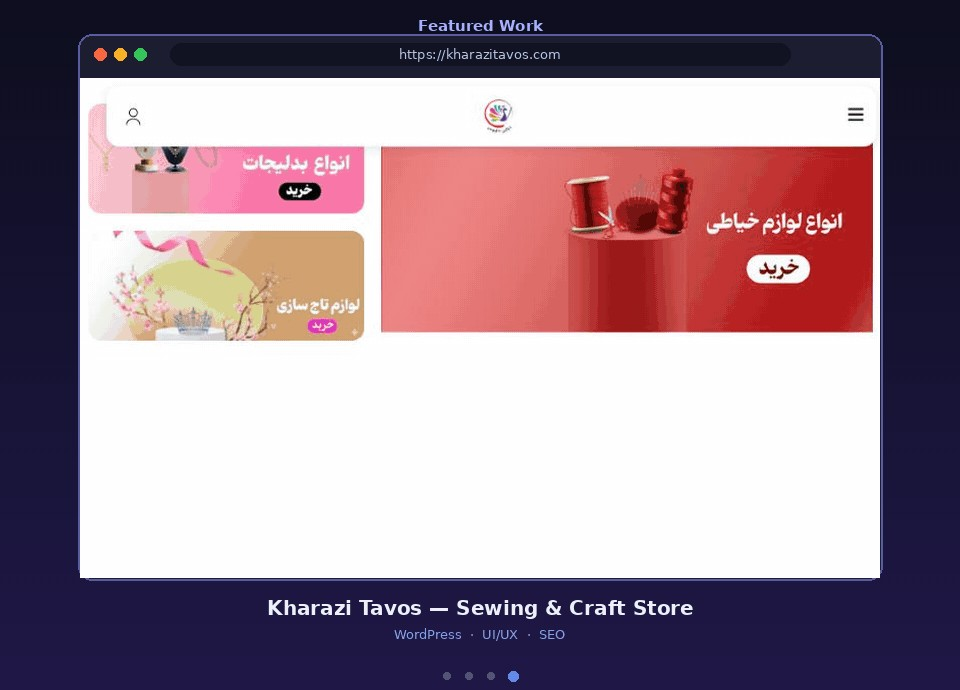

<h1 align="center">Kharazi Tavos — Sewing & Craft Supplies</h1>

<b>خرازی طاووس</b> · <a href="https://kharazitavos.com">kharazitavos.com</a>

  

  
  
  
  

---

### 📌 About the Project

An online store for sewing, jewelry-making and craft supplies.

### ✨ Features

- Visual category cards (sewing, beads, crowns, ribbons)
- Promotional banner grid
- Mobile app-style bottom navigation
- Product search
- Shopping cart and user account
- Fully responsive layout

### 🛠 My Role

- UI/UX design and layout
- WordPress & WooCommerce development
- Performance and SEO optimization

### 🔗 Live Website

👉 **[kharazitavos.com](https://kharazitavos.com)**

---

> 🔒 This is a **showcase** repository. The source code is private for client confidentiality.
> Interested in a similar project? Contact me on Telegram: **[@fesqhli](https://t.me/fesqhli)**

Made by <a href="https://github.com/zeroux-dev">ZERO (zeroux-dev)</a>

